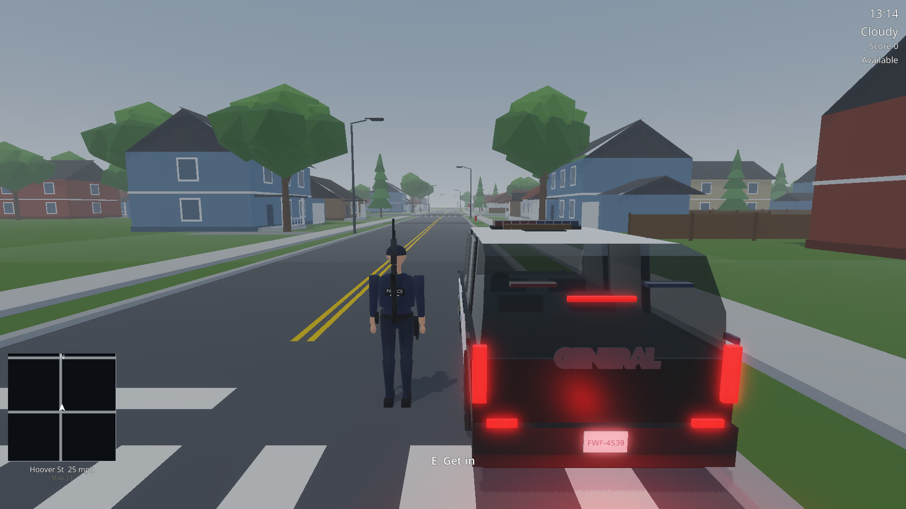
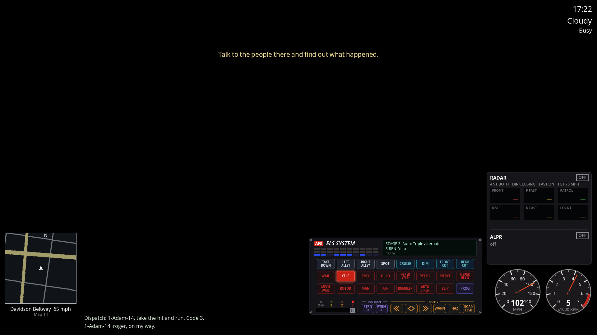

# Blue Line Patrol

[Website](https://talkdedsec.com) · [License](LICENSE) · [Security](SECURITY.md) · [Türkçe](README.tr.md)



A third-person police patrol simulator built in **Godot 4.7** (Jolt Physics, Forward+). Take calls from dispatch, run plates and traffic stops, chase suspects by car and on foot, and drive with a full ELS light and siren panel. The city, vehicles, characters, sounds and interiors are original low-poly assets generated from scripts.

This is a private personal-use project. All assets are original.

## Features

- Procedural city with a road graph, traffic lights, day and night cycle, weather and a lighting system
- Patrol vehicles with driving physics, ELS light rig, doors, damage smoke and a follow camera
- Officer controller, NPCs with animations, three weapons (pistol, patrol rifle, shotgun), crosshair, recoil and effects
- ELS SYSTEM panel with detailed light patterns, RADAR, ALPR, minimap, gauges and synthesized sirens
- Dispatch calls with radio voice, MDT terminal, traffic stop dialogue, citations and arrests
- Pursuits with the PIT authorization flow, backup units, foot chases, Taser and cuffing
- Scripted demo scenarios and a Movie Maker recording pipeline



## Run

1. Install [Godot 4.7.2](https://godotengine.org/download) (standard build).
2. Open the folder as a project, or run:

```bash
godot --path . 
```

Asset imports run on the first launch and take a minute or two.

## Controls

| Key | Action |
|---|---|
| W A S D, mouse, Shift | move, look, walk |
| 5 | draw / holster weapon (click the window once first so the mouse is captured) |
| 1 / 2 / 3 | draw pistol / patrol rifle / shotgun |
| LMB, RMB, hold R | fire, aim, reload |
| E | get in the car, cuff, process, talk (shown as a prompt) |
| W / S, A / D, Space, F | drive, steer, handbrake, get out |
| Q, X, H, L | emergency lights, siren, air horn, headlights |
| V, G, P | radar on/off, lock, plate reader |
| Tab | MDT |
| Alt | release the mouse (click the ELS panel); Esc to capture again |
| Y / N | accept / pass a call |
| In a pursuit: R, B, C, Z | request PIT, backup, join, call off |

## Project layout

| Path | Contents |
|---|---|
| `scripts/` | game code (world, vehicles, characters, weapons, HUD, ELS, MDT, pursuit, traffic) |
| `blender/` | Blender scripts that generate the models |
| `assets/` | generated models and synthesized audio |
| `scenarios/` | scripted demo scenarios |
| `docs/` | architecture notes (`MIMARI.md`), module APIs (`docs/api/`) |
| `araclar/` | helper scripts (locked Godot runner, recording) |

Generated models are rebuilt with Blender 5.2 (`blender/*/build_all.sh` or the individual scripts).

## Status

Playable, in active development. Some mechanics (reload timing, damage model, PIT speed threshold, building interiors and others) are design assumptions; each module lists them under "Tasarım varsayımları" in `docs/api/`.

## License

All rights reserved, personal use only. See [LICENSE](LICENSE).

---

Made by [Talkdedsec](https://talkdedsec.com).
